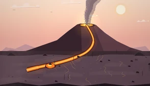
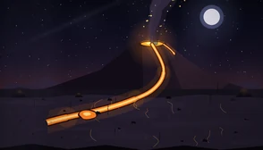

# Deskland Preview · Unlocked Edition

**Adaptive Windows wallpaper that makes your desktop icons part of the scenery.**

Deskland turns the space around your icons into a living landscape. Move, add or remove an icon and the beach, meadow, volcano, clouds and shadows quietly reshape around it — in real time, without AI, an account or an API key.

This is the **free, open-source Preview**, not a time-limited trial — and in this fork **every theme is unlocked and playable**. It includes complete implementations of all fifteen themes, the Windows host, settings and sharing tools.

**English** · [简体中文](#中文说明) · [Official website](https://deskland.app) · [Features](#features) · [Build from source](#build-from-source)




## This fork: everything unlocked

- **15 playable themes**, up from 2: Volcano, Volcano at Night, Meadow, Beach, Maldives, Lake, Sky, Ocean, Forest, Pink Forest, Hand-drawn City, Colorful City, Old Map, Nautical Chart, Lotus Pond.
- The eleven themes that were only locked preview cards in the upstream Preview are **implemented from scratch** here (procedural Canvas 2D scenes with their own settings).
- The lock UI, the purchase dialog and the entitlement check are removed: every theme in `prototype/themes.json` is `status: ready` and `product: free`, and the host accepts any theme that has a page.
- Two brand-new themes were added: **Volcano** and **Volcano at Night**, with lava rivers that flow around your icons.

## Included themes

| Volcano | Volcano at Night |
| --- | --- |
|  |  |
| A glowing crater above a plain of cooled lava; the lava river bends around your icons. | Lava glows in the dark, embers rise into the stars. |

| Beach | Meadow |
| --- | --- |
|  |  |
| Turquoise waves, kayaks, seabirds and coconut palms. | Drifting clouds and shadows, a boy flying a kite and a little black cat. |

The theme browser also contains Maldives, Lake, Sky, Ocean, Forest, Pink Forest, Hand-drawn City, Colorful City, Old Map, Nautical Chart and Lotus Pond — all fully playable.

## Features

- **Adaptive scenery:** uses the real positions of desktop icons and transitions smoothly when they move.
- **Fifteen complete themes:** every theme has its own page, parameters and saved settings.
- **Made for the desktop:** tray controls, startup on sign-in and automatic pause when a window is maximized or full-screen.
- **Private sharing:** image and animation exports use sample icons and color blocks, never a screenshot of your desktop or real file names.
- **Independent installation:** Preview uses its own install directory, settings, startup entry and instance identity, so it can coexist with other Deskland builds.
- **English and Simplified Chinese:** no sign-in, purchase restoration, update service or store API is included.

## Requirements

- Windows 10 or Windows 11, 64-bit.
- Microsoft Edge WebView2 Runtime.
- PowerShell and the .NET Framework C# compiler included with Windows; no .NET SDK installation is required.
- An internet connection for the first build, which downloads the WebView2 development library.
- Node.js only if you want to run the browser preview.

Currently, Deskland renders on the **primary monitor** and targets 30 fps on integrated graphics.

## Build from source

Open PowerShell in the repository root:

```powershell
powershell -ExecutionPolicy Bypass -File host\build.ps1
host\bin\Deskland.exe
```

Keep `host/` and `prototype/` together. Build output is written to `host/bin/`.

Run the program again or double-click its tray icon to open Settings. To exit and restore the original Windows wallpaper, use the tray menu or run:

```powershell
host\bin\Deskland.exe --exit
```

Preview settings and logs are stored separately in `%LOCALAPPDATA%\DesklandPreview`.

## Browser preview

```powershell
node prototype\serve.mjs
```

Open **http://localhost:5178/settings.html**. The browser uses sample icons; adaptation to real desktop icons requires the Windows host.

## Windows installer

Build the NSIS installer without installing global development tools:

```powershell
powershell -ExecutionPolicy Bypass -File tools\build-installer.ps1
```

The first build downloads portable NSIS and Microsoft's WebView2 bootstrapper. Artifacts are written to `dist/` with SHA256 checksums and a matching source ZIP.

The installer targets the current user's `Programs\Deskland Preview` directory and does not require administrator rights. If WebView2 is missing, its bootstrapper requires an internet connection. Uninstalling preserves user settings.

[Download Deskland Preview for Windows](https://github.com/BLEZZ0102/Deskland/releases/latest). The installer is unsigned, so Windows SmartScreen may show a warning.

## Project layout

| Path | Contents |
| --- | --- |
| `host/` | Windows host, build scripts and application manifest |
| `prototype/scene.js` | Shared Canvas 2D scene engine for the new themes (icon field, caching, pause, preview) |
| `prototype/scenes/` | One scene module per new theme (volcano, water, clouds, forest, maps) |
| `prototype/flat.html` | Beach theme |
| `prototype/meadow.html` | Meadow theme |
| `prototype/settings.html` | Settings interface |
| `prototype/themes.json` | Theme catalogue (all themes unlocked) |
| `prototype/share.js` | Privacy-preserving image and animation sharing |
| `prototype/assets/` | Images used by the included themes |
| `tools/` | Installer build tooling, `gen-themes.mjs`, `gen-i18n-themes.mjs` |

## Known limitations

- Only the primary monitor is supported.
- Windows Spotlight or a wallpaper slideshow can briefly flash when Windows changes the background image.
- The eleven previously locked themes are new, procedural implementations drawn with the shared Canvas 2D engine — they follow each theme's description and palette, not the original paid theme code (which is not part of this repository).
- Preview does not include account sign-in, entitlement restoration or automatic updates.

## Credits and license

Source code and included theme assets are released under [GPL-3.0](LICENSE). Third-party dependencies are listed in [THIRD_PARTY_NOTICES.md](THIRD_PARTY_NOTICES.md).

The Deskland name and icon are not licensed as trademarks; modified distributions should use their own name and icon. See [TRADEMARKS.md](TRADEMARKS.md).

Issues and suggestions are welcome through GitHub Issues. This is an independent project, so immediate responses are not guaranteed.

---

## 中文说明

[English](#deskland-preview) · **简体中文**

**让桌面图标成为风景的一部分。**

Deskland 是一款 Windows 自适应动态壁纸。移动、添加或删除桌面图标时，海岸线、草地、云朵和阴影会实时围绕图标调整。全部在本地实时演算，不使用 AI，无需账号或 API Key。

本仓库是**免费的开源体验版**；在这个分支里**全部主题都已解锁**，包含 15 个可玩主题的完整实现、Windows 宿主、设置界面与分享工具。

[官方网站](https://deskland.app) · [从源码运行](#build-from-source) · [许可](#credits-and-license)

### 本分支：全部解锁

- **15 个可玩主题**（原版只有 2 个）：火山、火山之夜、草地、沙滩、马尔代夫、湖泊、天空、大海、森林、粉色森林、手绘城市、彩色城市、老地图、航海地图、荷塘。
- 原版只有锁定缩略图的 11 个主题，在这里**从零实现**（程序化 Canvas 2D 场景，各有自己的参数）。
- 去掉锁定遮罩、购买弹窗和授权检查：`prototype/themes.json` 里所有主题都是 `status: ready`、`product: free`，宿主接受任何有页面的主题。
- 新增两个主题：**火山** 与 **火山之夜**，熔岩河会绕开你的图标。

### 包含的主题

| 火山 | 火山之夜 |
| --- | --- |
|  |  |
| 赤红的火山口与冷却的黑色熔岩原，熔岩河绕着图标流下。 | 夜色里的火山：熔岩河发光，火星升上星空。 |

| 沙滩 | 草地 |
| --- | --- |
|  |  |
| 海浪、皮划艇、海鸟和椰子树。 | 漂浮的云与云影、放风筝的男孩和小黑猫。 |

主题列表里还有马尔代夫、湖泊、天空、大海、森林、粉色森林、手绘城市、彩色城市、老地图、航海地图和荷塘——全部可玩。

### 功能

- **图标自适应：**读取真实桌面图标的位置，在移动、添加或删除时平滑调整场景。
- **十五个完整主题：**每个主题都有自己的页面、参数，设置自动保存。
- **适合常驻桌面：**托盘控制、开机自动启动，前台窗口最大化或全屏时自动暂停。
- **隐私分享：**图片和动画使用示例图标与名字色块，不截取桌面窗口或真实文件名。
- **独立安装：**安装目录、用户数据、启动项和运行实例标识均独立，可与其他 Deskland 版本共存。
- **简体中文和英文：**不包含登录、购买恢复、自动更新或商店接口。

### 系统要求

- Windows 10 / Windows 11，64 位。
- Microsoft Edge WebView2 Runtime。
- 使用 Windows 自带的 .NET Framework C# 编译器，无需安装 .NET SDK。
- 第一次构建需要联网下载 WebView2 开发库。
- 仅浏览器预览需要 Node.js。

目前只覆盖**主显示器**，以核显 30fps 为目标。

### 从源码运行

在仓库根目录打开 PowerShell：

```powershell
powershell -ExecutionPolicy Bypass -File host\build.ps1
host\bin\Deskland.exe
```

请保持 `host/` 和 `prototype/` 的相对目录结构，编译结果位于 `host/bin/`。

再次运行程序或双击托盘图标可打开设置。退出并恢复系统原壁纸，请使用托盘菜单或执行：

```powershell
host\bin\Deskland.exe --exit
```

体验版的设置与日志独立保存在 `%LOCALAPPDATA%\DesklandPreview`。

### 浏览器预览

```powershell
node prototype\serve.mjs
```

打开 **http://localhost:5178/settings.html**。浏览器使用示例图标，真实桌面图标适配需要 Windows 宿主。

### Windows 安装包

```powershell
powershell -ExecutionPolicy Bypass -File tools\build-installer.ps1
```

首次构建会下载便携版 NSIS 和微软 WebView2 引导程序，无需安装全局开发工具。产物位于 `dist/`，附 SHA256 校验文件和对应源码 ZIP。

安装包安装到当前用户的 `Programs\Deskland Preview` 目录，无需管理员权限。缺少 WebView2 时需要联网安装；卸载保留用户设置。

[下载 Deskland Preview Windows 安装包](https://github.com/BLEZZ0102/Deskland/releases/latest)。安装包未签名，Windows SmartScreen 可能显示提示。

### 目录结构

| 路径 | 用途 |
| --- | --- |
| `host/` | Windows 宿主、构建脚本与清单 |
| `prototype/flat.html` | 沙滩主题 |
| `prototype/meadow.html` | 草地主题 |
| `prototype/settings.html` | 设置界面 |
| `prototype/themes.json` | 免费主题完整定义及锁定主题展示信息 |
| `prototype/share.js` | 隐私保护的图片和动画分享 |
| `prototype/assets/` | 随附主题图片素材 |
| `tools/` | 安装包构建工具 |

### 已知限制

- 目前只支持主显示器。
- 使用 Windows 聚焦或壁纸幻灯片时，系统换图可能造成短暂闪烁。
- 体验版不包含账号登录、购买恢复、自动更新或其他主题实现。

### 许可与反馈

项目源码和随附主题素材按 [GPL-3.0](LICENSE) 发布，第三方依赖见 [THIRD_PARTY_NOTICES.md](THIRD_PARTY_NOTICES.md)。

Deskland 名称与图标不作为商标授权授予；修改版应使用自己的名称和图标，详见 [TRADEMARKS.md](TRADEMARKS.md)。

欢迎通过 GitHub Issues 反馈问题和建议。个人项目，不保证即时回复。
